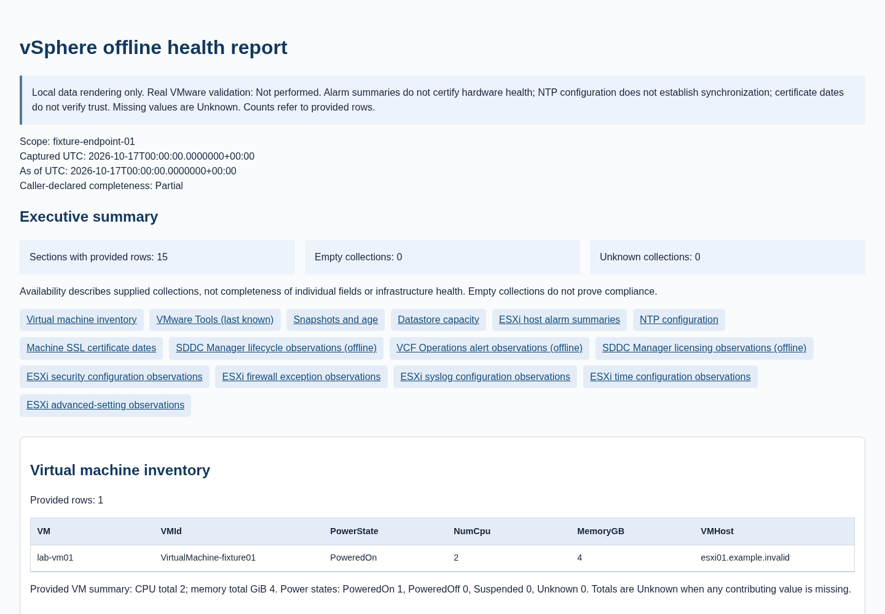

# VMware Community Toolkit

[Español](README.es.md)

PowerShell utilities for vSphere inventory, ESXi configuration observations, snapshot and datastore reporting, offline VCF export analysis, inventory comparison and portable HTML reports. An independent community project; no affiliation with VMware or Broadcom.

Live readers require an **explicit authorized PowerCLI connection**. Offline comparison, VCF analyzers and HTML rendering require no VMware connection. Configuration observations are not security/compliance verdicts. Missing evidence stays Unknown; empty results do not prove complete visibility.

**MIT — Copyright (c) 2026 Daniel Fuentes.** See [LICENSE](LICENSE) and [provenance](PROVENANCE.md). The `v0.1.0-rc5` source is [public on GitHub](https://github.com/danielfuentespl/vmware-community-toolkit); no release or stable tag has been created. Keep the complete directory tree. [Installation and first use](docs/GETTING-STARTED.md) · [Compatibility](docs/COMPATIBILITY.md) · [Examples](examples/README.md).

## Start offline

With an existing PowerShell session, run from the complete repository root. This needs no PowerCLI, Pester, credentials or network access:

```powershell
./scripts/Invoke-VMwareToolkit.ps1 -ListProfiles
./scripts/Invoke-VMwareToolkit.ps1 -ListChecks
$demoPath = Join-Path ([IO.Path]::GetTempPath()) ('vmware-toolkit-demo-' + [guid]::NewGuid().ToString('N') + '.html')
$demo = ./examples/Invoke-CommunityOfflineDemo.ps1 -OutputPath $demoPath
$demo.Inventory | Select-Object VM, PowerState, NumCpu, MemoryGB
$demo.Snapshots | Select-Object VM, Snapshot, Created, SizeGB
$demo.EsxiAudit.HostSecurity
$demo.Changes
$demo.VCF.OperationsAlerts
$demo.Report
```

The demo uses fabricated VM/snapshot/ESXi **output models**, not live PowerCLI calls. Comparison, all seven VCF adapters and HTML rendering execute locally against those fixtures. It produces one new HTML file, five comparison observations and no infrastructure change. The temporary path above is for fictional data only; real evidence belongs in an approved restricted directory outside Git. Existing files are refused. See [examples](examples/README.md) for individual commands.

## Available tools

25 toolkit entry points plus one auxiliary lab harness are listed below. Keep `scripts/Private` and the rest of the checkout beside the scripts. Use `Get-Help ./scripts/<category>/<tool>.ps1 -Full` for each parameter contract.

### VM reporting

| Tool | Purpose and boundary |
|---|---|
| [Get-VMInventory.ps1](scripts/Reporting/Get-VMInventory.ps1) | VM identity, power, CPU, memory and host |
| [Get-VMwareToolsStatus.ps1](scripts/Reporting/Get-VMwareToolsStatus.ps1) | Last-known VMware Tools version and running state |
| [Get-SnapshotReport.ps1](scripts/Reporting/Get-SnapshotReport.ps1) | Snapshot identity, creation date and size |
| [Get-OldSnapshots.ps1](scripts/Reporting/Get-OldSnapshots.ps1) | Snapshots older than an elapsed-day threshold; no deletion |
| [Get-VMHostDnsReport.ps1](scripts/Reporting/Get-VMHostDnsReport.ps1) | DNS servers, domain and search suffixes |

### Host and storage observations

| Tool | Purpose and boundary |
|---|---|
| [Get-VMHostHealth.ps1](scripts/Health/Get-VMHostHealth.ps1) | Host alarm summary and connection state; not hardware certification |
| [Get-DatastoreCapacity.ps1](scripts/Storage/Get-DatastoreCapacity.ps1) | Accessible datastore capacity/free/used GiB |

### ESXi configuration and security observations

| Tool | Purpose and boundary |
|---|---|
| [Get-VMHostSecurityConfiguration.ps1](scripts/Security/Get-VMHostSecurityConfiguration.ps1) | Reported lockdown mode and service configuration |
| [Get-VMHostFirewallReport.ps1](scripts/Network/Get-VMHostFirewallReport.ps1) | Firewall exceptions and reported ports/protocols |
| [Get-VMHostSyslogConfiguration.ps1](scripts/Logging/Get-VMHostSyslogConfiguration.ps1) | Five reviewed syslog settings; no delivery verification |
| [Get-VMHostTimeConfiguration.ps1](scripts/Network/Get-VMHostTimeConfiguration.ps1) | NTP configuration and optional time-service observations |
| [Get-VMHostAdvancedSettings.ps1](scripts/Security/Get-VMHostAdvancedSettings.ps1) | Exact selected keys; unrelated values withheld |
| [Get-VMHostNtpConfiguration.ps1](scripts/Network/Get-VMHostNtpConfiguration.ps1) | Configured NTP servers; no independent synchronization test |
| [Get-VMCertificateExpiry.ps1](scripts/Security/Get-VMCertificateExpiry.ps1) | Machine SSL date windows; no certificate trust verdict |

### Offline reporting and comparison

| Tool | Purpose and boundary |
|---|---|
| [New-vSphereHealthReport.ps1](scripts/Reporting/New-vSphereHealthReport.ps1) | Portable local HTML from structured data, with optional ESXi/VCF sections |
| [Compare-vSphereInventory.ps1](scripts/Reporting/Compare-vSphereInventory.ps1) | Scoped VM additions/removals and CPU/memory/power differences |

### Experimental offline VCF analysis

| Tool | Purpose and boundary |
|---|---|
| [Get-VCFInventory.ps1](scripts/VCF/Get-VCFInventory.ps1) | SDDC Manager domain inventory and operational states |
| [Get-VCFHealth.ps1](scripts/VCF/Get-VCFHealth.ps1) | Historical SoS task states; current health stays Unknown |
| [Get-VCFVersions.ps1](scripts/VCF/Get-VCFVersions.ps1) | SDDC Manager versions; not the complete VCF BOM |
| [Get-VCFCertificates.ps1](scripts/VCF/Get-VCFCertificates.ps1) | Reported certificate expiry and retrieval-error observations |
| [Get-VCFLifecycleStatus.ps1](scripts/VCF/Get-VCFLifecycleStatus.ps1) | Domain upgrade states and completed/total resource counts |
| [Get-VCFOperationsAlerts.ps1](scripts/VCF/Get-VCFOperationsAlerts.ps1) | Complete Operations alert pages; raw time values retain Unknown units |
| [Get-VCFLicensingReport.ps1](scripts/VCF/Get-VCFLicensingReport.ps1) | Single SYSTEM LicensingInfo; registration and subscription are distinct |

### Execution and guarded preview

| Tool | Purpose and boundary |
|---|---|
| [Invoke-VMwareToolkit.ps1](scripts/Invoke-VMwareToolkit.ps1) | Fixed read-only profiles/checks, structured results and optional HTML |
| [Set-VMHostDnsServers.ps1](scripts/Network/Set-VMHostDnsServers.ps1) | Locked to WhatIf; real DNS writes are blocked and runner excludes it |
| [Invoke-ToolkitLabValidation.ps1](scripts/Lab/Invoke-ToolkitLabValidation.ps1) | Auxiliary offline preflight; Connect needs separate explicit authorization |

## Central executor

[Invoke-VMwareToolkit](docs/CENTRAL-RUNNER.md) executes 14 fixed read-only checks sequentially. Offline discovery (`-ListProfiles`, `-ListChecks`) never queries VMware. Execution requires one existing explicit `-Server`, an `-EndpointType` declaration and an opaque `-ScopeId`; it never logs in or accepts arbitrary script paths/credentials. Select a profile **or** `-Checks`, never both.

| Profile | Checks |
|---|---|
| Inventory | VMInventory, Tools, Datastores |
| Operations | VMInventory, Tools, Snapshots, OldSnapshots, Datastores, HostHealth, Dns, Ntp, Time |
| Security | Certificates, HostSecurity, Firewall, Syslog, Time, AdvancedSettings |
| All | VMInventory, Tools, Snapshots, OldSnapshots, Datastores, HostHealth, Dns, Ntp, Certificates, HostSecurity, Firewall, Syslog, Time, AdvancedSettings |

Filters include VMName, VMHostName, DatastoreName, RuleName and exact SettingName keys. The runner reuses snapshot/time/setting sources where possible and applies retained-row budgets. Those budgets do not bound provider buffers, API-call count or runtime. By default it stops new work after a failure; ContinueOnError allows independent checks to continue.

State exposes **Success, Failed, Unknown, NotRun** while preserving legacy Status/Reason and overall Outcome. Empty execution success does not prove full visibility. PartialFailure maps to State=Failed; inspect ExecutionCompleted and Report as well as per-check states. Structured failures are not necessarily terminating errors. WhatIf suppresses requested HTML creation only: read queries still run.

The following syntax is **future authorized lab use only**, not an offline command. `$connection` must already be a separately authorized explicit connection with strict TLS; `$newPrivateHtmlPath` must be a new file in a restricted existing directory:

```powershell
$result = ./scripts/Invoke-VMwareToolkit.ps1 -Server $connection -EndpointType vCenter -ScopeId 'authorized-lab-scope' -Profile Inventory -VMName 'lab-*'
$result.Checks | Select-Object Check, Requested, Status, State, RowCount, Message
$result = ./scripts/Invoke-VMwareToolkit.ps1 -Server $connection -EndpointType vCenter -ScopeId 'authorized-lab-scope' -Checks VMInventory,Tools,Snapshots -VMName 'lab-*' -HtmlPath $newPrivateHtmlPath
if (-not $result.ExecutionCompleted) { throw 'Execution incomplete; inspect sanitized statuses privately.' }
```

Follow [first authorized vCenter session](docs/VCENTER-FIRST-RUN.md) before access. Required privileges are the union of selected reads; exact least-privilege roles remain unverified. Snapshot size may need Datastore.Browse. Direct ESXi has a narrower inventory/policy boundary; certificate retrieval is explicitly blocked there. A successful query does not prove complete permission visibility. The DNS preview is excluded from all profiles and real DNS changes stay locked.

## HTML demonstration

[Open the fictional portable report](docs/demo/community-report.html) · [desktop PNG](docs/demo/community-desktop.png) · [narrow-window PNG](docs/demo/community-narrow.png) · [capture provenance and reproduction](docs/demo/README.md)



The report has availability counts, section navigation, scrollable responsive tables and optional execution/ESXi/VCF observations. It escapes HTML, uses CSP, has no JavaScript/CDN/telemetry and refuses overwrite. Missing collections/fields are Unknown; explicit empty arrays mean no supplied records. Availability is not health or compliance. Source-specific VCF sections do not merge SDDC Manager, Operations or vCenter indicators. Screenshots show invented fixtures, not a VMware UI or a real environment. [Schema and limitations](docs/UNIFIED-REPORTING.md).

## Requirements and installation

| Task | Required dependencies |
|---|---|
| Offline demo, HTML, comparison and VCF JSON processing | Existing PowerShell; no PowerCLI, account or network |
| Live vSphere/ESXi readers | Official VMware.VimAutomation.Core and dependencies, trusted TLS, an authorized explicit connection and sufficient read permissions |
| Automated development checks | Pester 6.2.0, PSScriptAnalyzer 1.25.0, Python 3.9+ standard library and Git for one temporary-repository test |
| Distribution verification | Python 3.9+ standard library; no Git, modules or network |

PowerShell 7.4+ is the source target; **7.6.7/Linux x64 is the locally executed runtime**. Other PowerShell versions, Windows/macOS and scale remain unverified. Python 3.14.7 was run locally; the standard-library code targets 3.9+. No runtime or vendor module is bundled. See [setup commands, tested module versions and TLS-safe connection](docs/GETTING-STARTED.md). No script installs dependencies automatically.

Start in the complete supplied directory. For a history-free distribution with SHA256SUMS, verify before use:

```bash
python3 -B tools/build_offline_candidate.py . --verify
```

Git source checkouts do not contain the generated distribution manifest. In an approved PowerShell session, inspect available commands with `Get-Help ./scripts/Invoke-VMwareToolkit.ps1 -Full`. Live use requires the separate [authorized-session procedure](docs/VCENTER-FIRST-RUN.md); credentials stay in memory and TLS validation remains enabled.

## Validation and compatibility

[Per-tool matrix](docs/TOOL-VALIDATION-MATRIX.md) distinguishes static analysis, offline simulation and limited real observations. Recorded live combinations: vCenter 8.0.3 build 24022515 and ESXi 8.0.3 build 24022510, with PowerCLI Core 13.5.1.25718932 / Vim 9.1.0.25718932. ESXi 9.0.1 build 24957456 has **unverified third-party media provenance** and no positive VM/snapshot coverage. These are observations, not broad VMware support or vendor certification.

**VCF analyzers are offline-only and have not been functionally validated against a real VCF deployment.** Mutable official API references do not establish VCF 9.x build compatibility. SourceVersion is descriptive; timestamp units, absent evidence and unsupported contracts are not guessed.

The public candidate passes **256 Pester cases and 13 Python tests**, plus configured PSScriptAnalyzer and redacted Gitleaks checks. [Validation methods and CI limits](VALIDATION.md) explain the scope. The GitHub workflow uses only mocks/fictional fixtures and verifies SHA-256-locked PSGallery test modules before extraction/import in a disposable runner; it needs no VMware credentials. The [hosted offline workflow](https://github.com/danielfuentespl/vmware-community-toolkit/actions/workflows/validate.yml) has run successfully; this does not extend VMware functional coverage.

With approved test dependencies already installed:

```powershell
./tests/Invoke-Validation.ps1
```

```bash
python3 -B -m unittest discover -s tests -p 'test_*.py'
python3 -B tools/check_public_content.py
```

Keep real exports, connection objects, credentials, identifiers and raw exceptions outside Git. Field allowlisting is not anonymization. No tests connect to VMware. The DNS setter is WhatIf-only and excluded from central execution; WhatIf on the central runner suppresses HTML writing, not read queries.

## Contributing

See [CONTRIBUTING](CONTRIBUTING.md), [security reporting](SECURITY.md), [community lab testing](docs/COMMUNITY-TESTING.md), [result template](docs/TEST-RESULT-TEMPLATE.md) and [changelog](CHANGELOG.md). Submit fictional reproductions and independently authorized provenance. Preserve MIT and required third-party notices. Do not submit real infrastructure exports/screenshots or infer compatibility from mocks.
